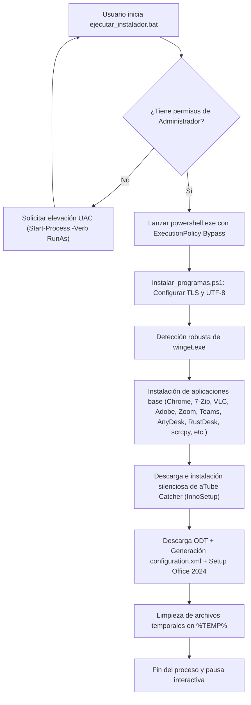

# 🎓 Guía Didáctica: Arquitectura y Funcionamiento del Instalador Desatendido

Esta guía didáctica explica en profundidad cómo funciona el sistema de despliegue automatizado contenido en este repositorio, los fundamentos de PowerShell aplicados a la administración de sistemas y cómo evitar los errores más comunes al automatizar tareas en Windows.

---

## 📑 Tabla de Contenidos

1. [Conceptos Fundamentales: ¿Qué es una Instalación Desatendida?](#1-conceptos-fundamentales-qué-es-una-instalación-desatendida)
2. [Flujo General de Ejecución](#2-flujo-general-de-ejecución)
3. [Análisis Paso a Paso del Script](#3-análisis-paso-a-paso-del-script)
   - [Fase 0: Elevación de Privilegios y Preparación de la Sesión](#fase-0-elevación-de-privilegios-y-preparación-de-la-sesión)
   - [Fase 1: Despliegue con Gestor de Paquetes Moderno (WinGet)](#fase-1-despliegue-con-gestor-de-paquetes-moderno-winget)
   - [Fase 2: Instalación Silenciosa Tradicional (InnoSetup - aTube Catcher)](#fase-2-instalación-silenciosa-tradicional-innosetup---atube-catcher)
   - [Fase 3: Despliegue Empresarial con XML (Microsoft Office LTSC 2024)](#fase-3-despliegue-empresarial-con-xml-microsoft-office-ltsc-2024)
   - [Fase 4: Limpieza y Control de Flujo](#fase-4-limpieza-y-control-de-flujo)
4. [Anatomía del Error de `err.txt`: Por qué Ocurrió y Qué Aprendemos](#4-anatomía-del-error-de-errtxt-por-qué-ocurrió-y-qué-aprendemos)
5. [Buenas Prácticas para Scripts en Entornos Windows](#5-buenas-prácticas-para-scripts-en-entornos-windows)

---

## 1. Conceptos Fundamentales: ¿Qué es una Instalación Desatendida?

Una **instalación desatendida** (también denominada silenciosa, *silent* o *headless*) es aquella que se ejecuta sin requerir interacción por parte del usuario. No se muestran asistentes con botones de "Siguiente", no se piden confirmaciones de rutas ni acuerdos de licencia de forma interactiva en pantalla.

### Ventajas:
- **Repetibilidad:** Se instalan exactamente los mismos programas y configuraciones en cada máquina.
- **Ahorro de tiempo:** En lugar de hacer clic durante 45 minutos en múltiples instaladores, un único script deja el ordenador listo de fondo.
- **Estandarización:** Evita la instalación accidental de barras de herramientas (*adware*) o complementos no deseados.

---

## 2. Flujo General de Ejecución

El siguiente diagrama ilustra cómo se comunican los componentes del proyecto:



---

## 3. Análisis Paso a Paso del Script

### Fase 0: Elevación de Privilegios y Preparación de la Sesión

#### A. El lanzador por lotes (`ejecutar_instalador.bat`)
Windows bloquea por defecto la ejecución de scripts `.ps1` mediante su política de seguridad (*Execution Policy*). Para que cualquier usuario pueda iniciarlo sin lidiar con la consola:
```cmd
net session >nul 2>&1
if %errorLevel% neq 0 (
    powershell.exe -NoProfile -Command "Start-Process '%~f0' -Verb RunAs"
    exit /b
)
powershell.exe -NoProfile -ExecutionPolicy Bypass -File "%~dp0instalar_programas.ps1"
```
- `net session`: Comando estándar de Windows que solo devuelve código de salida `0` si el proceso posee un *token* de administrador.
- `-Verb RunAs`: Invoca el diálogo UAC pidiendo consentimiento al usuario.
- `-ExecutionPolicy Bypass`: Permite ejecutar el script actual en memoria sin cambiar permanentemente la seguridad global del sistema operativo.
- `%~dp0`: Variable de entorno de Batch que contiene la ruta exacta de la carpeta donde se encuentra el archivo `.bat`.

#### B. Codificación y optimización de red en PowerShell
```powershell
[Console]::OutputEncoding = [System.Text.Encoding]::UTF8
$OutputEncoding = [System.Text.Encoding]::UTF8

[Net.ServicePointManager]::SecurityProtocol = [Net.SecurityProtocolType]::Tls12 -bor [Net.SecurityProtocolType]::Tls13
$ProgressPreference = 'SilentlyContinue'
```
- **UTF-8:** Evita que caracteres acentuados o símbolos del idioma español se muestren como caracteres extraños en la consola.
- **TLS 1.2 / 1.3:** Los servidores web modernos rechazan conexiones con TLS 1.0/1.1 por motivos de seguridad. Esta directiva fuerza el uso de protocolos criptográficos actuales.
- `$ProgressPreference = 'SilentlyContinue'`: **Optimización clave en PowerShell 5.1.** Por defecto, `Invoke-WebRequest` dibuja una barra de progreso carácter a carácter en pantalla que satura la CPU y puede ralentizar descargas grandes hasta 10 veces. Al silenciarla, la velocidad de descarga pasa a ser óptima.

#### C. Política de ejecución de PowerShell

Windows bloquea por defecto los scripts `.ps1` mediante la *Execution Policy*. El lanzador `.bat` ya utiliza `-ExecutionPolicy Bypass` para el proceso concreto, pero además el script comprueba y ajusta la política persistente:

```powershell
$gpoMachine = Get-ExecutionPolicy -Scope MachinePolicy
$gpoUser    = Get-ExecutionPolicy -Scope UserPolicy

if ($gpoMachine -ne 'Undefined' -or $gpoUser -ne 'Undefined') {
    # La política viene impuesta por GPO: no se puede cambiar
} else {
    foreach ($scope in @('LocalMachine', 'CurrentUser')) {
        if ((Get-ExecutionPolicy -Scope $scope) -ne 'Unrestricted') {
            Set-ExecutionPolicy -Scope $scope -ExecutionPolicy Unrestricted -Force
        }
    }
}
```

**Orden de precedencia de la política** (de mayor a menor):
1. `MachinePolicy` / `UserPolicy` (directiva de grupo, no modificable por el usuario).
2. `Process` (parámetro `-ExecutionPolicy` de la línea de comandos).
3. `CurrentUser`.
4. `LocalMachine`.

Consecuencias prácticas:
- Si existe una **GPO**, `Set-ExecutionPolicy` no puede imponerse: el script lo detecta, avisa y sigue funcionando gracias a `-ExecutionPolicy Bypass`.
- Si no existe GPO, se ajustan `LocalMachine` y `CurrentUser` a `Unrestricted`, de modo que los scripts `.ps1` puedan ejecutarse directamente en el futuro.
- `Unrestricted` no exige firma digital; en entornos corporativos conviene valorar `RemoteSigned`.

---

### Fase 1: Despliegue con Gestor de Paquetes Moderno (WinGet)

**Windows Package Manager (WinGet)** es la herramienta oficial de Microsoft para gestionar software desde la línea de comandos, similar a `apt` en Debian/Ubuntu o `brew` en macOS.

#### El desafío de WinGet en sesiones de Administrador
Cuando un script se eleva a Administrador, la variable de entorno `PATH` puede no incluir la ruta `%LOCALAPPDATA%\Microsoft\WindowsApps`, provocando que el comando `winget` no sea reconocido directamente. Para resolver esto, implementamos una función de búsqueda progresiva:

```powershell
function Get-WinGetExecutable {
    # 1. Comprobar PATH
    $cmd = Get-Command "winget" -ErrorAction SilentlyContinue
    if ($cmd) { return "winget" }

    # 2. Comprobar en Program Files (WindowsApps del sistema)
    $appInstaller = Get-ChildItem "$env:ProgramFiles\WindowsApps\Microsoft.DesktopAppInstaller_*_x64__8wekyb3d8bbwe\winget.exe" -ErrorAction SilentlyContinue | Select-Object -First 1
    if ($appInstaller -and (Test-Path $appInstaller.FullName)) {
        return $appInstaller.FullName
    }

    # 3. Comprobar por paquete AppX registrado
    $pkg = Get-AppxPackage -AllUsers -Name "Microsoft.DesktopAppInstaller" -ErrorAction SilentlyContinue | Select-Object -First 1
    if ($pkg -and $pkg.InstallLocation) {
        $candidate = Join-Path $pkg.InstallLocation "winget.exe"
        if (Test-Path $candidate) { return $candidate }
    }

    return $null
}
```

#### Los parámetros de instalación:
```powershell
& $wingetCmd install --id $app.Id -e --silent --accept-source-agreements --accept-package-agreements --force
```
- `--id <Identificador>`: Busca el paquete por su identificador unívoco oficial (ej. `Google.Chrome`), evitando coincidencias ambiguas.
- `-e` (*--exact*): Exige que el ID coincida exactamente.
- `--silent`: Solicita al instalador subyacente (MSI, Inno, NSIS) que se instale sin mostrar ventanas gráficas.
- `--accept-source-agreements` y `--accept-package-agreements`: Acepta automáticamente las licencias del repositorio y del fabricante.
- `--force`: Fuerza la continuación del proceso ante advertencias no críticas.

#### Casos particulares: Zoom, Teams, AnyDesk, RustDesk y scrcpy

El array `$wingetApps` incluye ahora también estas cinco aplicaciones:

```powershell
@{ Name = "Zoom";            Id = "Zoom.Zoom" },
@{ Name = "Microsoft Teams"; Id = "Microsoft.Teams"; Appx = "MSTeams" },
@{ Name = "AnyDesk";         Id = "AnyDeskSoftwareGmbH.AnyDesk" },
@{ Name = "RustDesk";        Id = "RustDesk.RustDesk" },
@{ Name = "scrcpy";          Id = "Genymobile.scrcpy" }
```

- **Zoom (`Zoom.Zoom`)** es un instalador tradicional (MSI/EXE) que acepta el modificador `--silent` sin problemas.
- **Microsoft Teams (`Microsoft.Teams`)** corresponde a la **nueva aplicación de Teams**, que se distribuye como paquete **MSIX**. Esto implica dos matices importantes:
  1. El equipo debe tener actualizado el componente **App Installer** (el mismo que proporciona WinGet). Si está obsoleto, la instalación de Teams puede fallar.
  2. `--silent` se transmite al instalador, pero al tratarse de una app empaquetada el resultado depende del propio paquete. Si Teams ya está instalado, WinGet devolverá un código distinto de `0` y el script lo mostrará como aviso (`[i] Código de retorno`), sin detener el resto del proceso.
- **AnyDesk (`AnyDeskSoftwareGmbH.AnyDesk`)** se instala de forma silenciosa como servicio. Tras la instalación, el acceso desatendido (sin que nadie acepte la conexión) debe configurarse aparte desde la interfaz de AnyDesk, estableciendo una contraseña de acceso no supervisado.
- **RustDesk (`RustDesk.RustDesk`)** es un escritorio remoto **de código abierto** (licencia AGPL-3.0). Se instala como servicio y funciona sin configuración con los servidores públicos de RustDesk. Sus particularidades:
  1. Permite usar un **servidor propio** (*self-hosted*) configurando ID/Relay Server y la clave pública en la aplicación; útil si no se quieren usar servidores de terceros.
  2. Como AnyDesk, para acceso no supervisado hay que fijar una **contraseña permanente** en la configuración de seguridad.
  3. Al ser una aplicación independiente, puede convivir sin conflicto con AnyDesk; el script instala ambas.
- **scrcpy (`Genymobile.scrcpy`)** es un caso especial: se distribuye como **ZIP portable**. WinGet lo descomprime y crea un alias de comando (`scrcpy`) en el PATH. No es un instalador MSI/EXE, por lo que:
  1. No aparece como programa tradicional en "Aplicaciones instaladas", sino como paquete portable de WinGet.
  2. Para funcionar necesita **ADB** (incluido en el ZIP de scrcpy) y un dispositivo Android con **Depuración USB** activada. La primera vez, el móvil mostrará un diálogo de autorización de la clave RSA.
  3. Ejemplos de uso: `scrcpy` (USB) o `adb connect <IP>:<puerto>` seguido de `scrcpy` para conexión inalámbrica.
  4. En equipos ARM64, WinGet selecciona automáticamente el binario `scrcpy-winarm64`.

> **Consejo didáctico:** para conocer los identificadores exactos disponibles se puede usar `winget search <nombre>`. Nunca se debe inventar un ID: si no coincide exactamente (`-e`), la instalación falla.

#### Idempotencia: no reinstalar lo que ya está

Antes de lanzar cada instalación, el bucle consulta el estado del paquete:

```powershell
if (Test-WingetAppInstalled -WingetExe $wingetCmd -Id $app.Id -AppxName $app.Appx) {
    Write-Host "    [=] $($app.Name) ya está instalado. Se omite." -ForegroundColor DarkGray
    continue
}
```

La función `Test-WingetAppInstalled` combina dos comprobaciones:

```powershell
function Test-WingetAppInstalled {
    param([string]$WingetExe, [string]$Id, [string]$AppxName)

    # 1. Paquetes MSIX/Appx (nueva app de Teams)
    if ($AppxName) {
        $appx = Get-AppxPackage -Name $AppxName -ErrorAction SilentlyContinue
        if ($appx) { return $true }
    }

    # 2. Paquetes registrados en WinGet
    if (-not $WingetExe) { return $false }
    try {
        $output = (& $WingetExe list --id $Id -e --accept-source-agreements 2>$null | Out-String)
        if ($LASTEXITCODE -ne 0) { return $false }
        if ($output -match '(?i)No\s+(installed\s+package|se\s+encontr)') { return $false }
        return $true
    } catch {
        return $false
    }
}
```

Detalles importantes:
- `winget list --id <ID> -e` devuelve un **código de salida distinto de cero** cuando no encuentra el paquete, por lo que se usa `$LASTEXITCODE` como señal principal.
- Algunas versiones antiguas devuelven `0` y escriben un mensaje de "no encontrado"; por eso se descarta también ese texto (en inglés y español).
- `continue` salta directamente a la siguiente iteración del `foreach`, de modo que el programa omitido no se descarga ni se ejecuta.
- Para **Teams** se consulta además el paquete Appx `MSTeams`, porque al ser MSIX su identificador en `winget list` no siempre coincide con `Microsoft.Teams`.

---

### Fase 2: Instalación Silenciosa Tradicional (InnoSetup - aTube Catcher)

Programas que no forman parte del catálogo oficial de WinGet se descargan directamente desde su servidor oficial y se ejecutan mediante sus respectivos parámetros de instalación desatendida.

Antes de descargar, el script comprueba el registro de Windows para saber si aTube Catcher ya existe:

```powershell
function Test-SoftwareInstalled {
    param([string]$NamePattern)

    $uninstallRoots = @(
        'HKLM:\SOFTWARE\Microsoft\Windows\CurrentVersion\Uninstall\*',
        'HKLM:\SOFTWARE\WOW6432Node\Microsoft\Windows\CurrentVersion\Uninstall\*',
        'HKCU:\SOFTWARE\Microsoft\Windows\CurrentVersion\Uninstall\*'
    )

    foreach ($root in $uninstallRoots) {
        $found = Get-ItemProperty -Path $root -ErrorAction SilentlyContinue |
                 Where-Object { $_.DisplayName -and $_.DisplayName -match $NamePattern } |
                 Select-Object -First 1
        if ($found) { return $true }
    }
    return $false
}
```

Se consultan las tres ubicaciones habituales porque los instaladores de 32 bits se registran en `WOW6432Node` y las instalaciones por usuario en `HKCU`. Si se detecta `aTube Catcher`, se omite toda la fase de descarga.

`aTube Catcher` utiliza el empaquetador **InnoSetup**. Los parámetros estándar de InnoSetup son:
```powershell
Start-Process -FilePath $aTubeInstaller -ArgumentList "/VERYSILENT /SUPPRESSMSGBOXES /NORESTART /SP-" -Wait -PassThru
```
- `/VERYSILENT`: Realiza la instalación sin mostrar barra de progreso ni ventana alguna.
- `/SUPPRESSMSGBOXES`: Oprime cualquier cuadro de diálogo emergente o mensaje modal.
- `/NORESTART`: Evita que el equipo se reinicie automáticamente tras la instalación.
- `/SP-`: Omite la pregunta inicial *"¿Desea continuar con la instalación?"*.
- `-Wait`: Detiene la ejecución del script de PowerShell hasta que el instalador finalice por completo.

---

### Fase 3: Despliegue Empresarial con XML (Microsoft Office LTSC 2024)

Microsoft Office no se distribuye mediante un único instalador `.exe` estándar. Microsoft utiliza la **Office Deployment Tool (ODT)** (*setup.exe*) y un archivo de configuración en formato XML.

Antes de descargar la ODT, el script verifica si Office 2024 ya está desplegado:

```powershell
function Test-Office2024Installed {
    $configKey = 'HKLM:\SOFTWARE\Microsoft\Office\ClickToRun\Configuration'
    if (Test-Path $configKey) {
        $config = Get-ItemProperty -Path $configKey -ErrorAction SilentlyContinue
        if ($config -and $config.ProductReleaseIds -match 'ProPlus2024Volume') {
            return $true
        }
    }
    return $false
}
```

Office Click-to-Run registra en `ProductReleaseIds` los productos instalados. Si aparece `ProPlus2024Volume`, se omite por completo la descarga de la ODT y la instalación, ahorrando varios gigabytes de tráfico y tiempo.

#### Estructura del XML de configuración:
```xml
<Configuration>
  <Add OfficeClientEdition="64" Channel="PerpetualVL2024">
    <Product ID="ProPlus2024Volume">
      <Language ID="es-es" />
      <ExcludeApp ID="Lync" />
    </Product>
  </Add>
  <RemoveMSI />
  <Display Level="None" AcceptEULA="TRUE" />
  <Property Name="AUTOACTIVATE" Value="0" />
</Configuration>
```
- `OfficeClientEdition="64"`: Descarga la arquitectura nativa de 64 bits.
- `Channel="PerpetualVL2024"`: Canal de actualización perpetua para licencias por volumen de Office 2024 (LTSC).
- `Product ID="ProPlus2024Volume"`: Paquete Office Professional Plus 2024 (Word, Excel, PowerPoint, Outlook, OneNote, Access).
- `<Language ID="es-es" />`: Idioma español (España).
- `<ExcludeApp ID="Lync" />`: Excluye Skype for Business (obsoleto).
- `<RemoveMSI />`: Desinstala automáticamente versiones antiguas de Office basadas en instalador MSI (Office 2016 o anteriores).
- `Display Level="None" AcceptEULA="TRUE"`: Oculta la interfaz gráfica y acepta el acuerdo de licencia de Microsoft.

---

### Fase 4: Limpieza y Control de Flujo

Al terminar la instalación, el script limpia el directorio temporal en `$env:TEMP\InstaladorDesatendido` para liberar espacio en el disco duro:
```powershell
Remove-Item -Path $WorkDir -Recurse -Force -ErrorAction SilentlyContinue
```

Y para evitar que la ventana se cierre de golpe si el usuario hizo doble clic:
```powershell
Write-Host "Presione ENTER para salir..." -ForegroundColor Yellow
$null = Read-Host
```
Se utiliza `Read-Host` en lugar de `$Host.UI.RawUI.ReadKey(...)` por tres motivos:
1. `ReadKey` no admite un argumento de tipo cadena como `"NoEcho,IncludeKeyDown"`; esa sintaxis provoca errores según la versión de PowerShell y el contexto de ejecución.
2. `Read-Host` funciona en consolas interactivas, sesiones elevadas, tareas programadas y entornos redirigidos (por ejemplo, SCCM o Intune).
3. Al no depender de la API de consola, no genera excepciones si no existe una ventana real asociada al proceso.

---

## 4. Anatomía del Error de `err.txt`: Por qué Ocurrió y Qué Aprendemos

El error capturado en [`err.txt`](err.txt) fue:
```text
En C:\Users\ROJO9263\Downloads\sc_basic_11\instalar_programas.ps1: 182 Carácter: 54
+ $null = $Host.UI.RawUI.ReadKey("NoEcho,IncludeKeyDown")
+                                                      ~~
Falta la cadena en el terminador: ".
    + CategoryInfo          : ParserError: (:) [], ParseException
    + FullyQualifiedErrorId : TerminatorExpectedAtEndOfString
```

### La trampa del "Here-String" en PowerShell
En PowerShell, las cadenas multilínea pueden declararse con la sintaxis *here-string*:
```powershell
$texto = @"
línea 1
línea 2
"@
```

Sin embargo, el analizador sintáctico (*parser*) de **Windows PowerShell 5.1** impone reglas inflexibles:
1. El delimitador de apertura `@"` debe ser el último carácter de la línea.
2. El delimitador de cierre `"@` **debe estar forzosamente en la primera columna (columna 0)**. Si tiene un solo espacio o tabulador de sangría, PowerShell **no lo reconoce como cierre**.
3. **El salto de línea debe coincidir con el formato del archivo:** Si el archivo se editó en Linux o con un editor que guardó en formato Unix (`LF` en lugar de `CRLF`), Windows PowerShell a menudo pasa por alto la marca de cierre.

### ¿Por qué la consola apuntó a la línea 182 si el error estaba en la línea 144?
Dado que PowerShell nunca encontró el cierre `"@` en la línea 144, consideró que **todas las líneas siguientes** (el código de ejecución de Office, la limpieza de temporales y los mensajes finales) **eran texto dentro de la cadena XML**.

Al llegar a la línea 182 (la última línea del script), el archivo terminó físicamente sin haber cerrado la comilla. Por esa razón, el motor reportó:
> *"Falta la cadena en el terminador"* en el último carácter del archivo (Línea 182, Carácter 54).

### La solución elegante:
En lugar de depender de la frágil sintaxis de *here-strings*, generamos el XML como un array de cadenas independientes:
```powershell
$configXmlLines = @(
    '<Configuration>'
    '  <Add OfficeClientEdition="64" Channel="PerpetualVL2024">'
    '    <Product ID="ProPlus2024Volume">'
    '      <Language ID="es-es" />'
    '      <ExcludeApp ID="Lync" />'
    '    </Product>'
    '  </Add>'
    '  <RemoveMSI />'
    '  <Display Level="None" AcceptEULA="TRUE" />'
    '  <Property Name="AUTOACTIVATE" Value="0" />'
    '</Configuration>'
)
$configXmlLines | Set-Content -Path $configXmlPath -Encoding UTF8
```
**Ventajas:**
- Permite sangrar el código respetando la legibilidad.
- Es 100% inmune a saltos de línea Unix (`LF`) o Windows (`CRLF`).
- `Set-Content` escribe automáticamente el archivo utilizando la codificación UTF-8 y los saltos de línea nativos del sistema.

### Endurecimiento adicional de la pausa final
Aunque el origen real del error estaba en el *here-string*, la línea que PowerShell señalaba (`ReadKey`) también se ha sustituido por `Read-Host`. De este modo:
- Desaparece por completo la construcción que aparecía en el mensaje de error.
- La pausa final es compatible con cualquier modo de ejecución (interactivo, elevado o desatendido).
- El archivo se guarda ahora en **UTF-8 con BOM**, para que Windows PowerShell 5.1 no malinterprete los caracteres acentuados del español.

### Ampliación del catálogo: Zoom, Teams, AnyDesk, RustDesk y scrcpy
La versión actual añade **Zoom** (`Zoom.Zoom`), **Microsoft Teams** (`Microsoft.Teams`), **AnyDesk** (`AnyDeskSoftwareGmbH.AnyDesk`), **RustDesk** (`RustDesk.RustDesk`) y **scrcpy** (`Genymobile.scrcpy`) al bloque de WinGet. Todos se instalan dentro del mismo bucle `foreach`, por lo que heredan automáticamente la detección de software ya instalado, el manejo de códigos de retorno y los acuerdos de licencia ya explicados en la Fase 1.

---

## 5. Buenas Prácticas para Scripts en Entornos Windows

1. **Usa siempre finales de línea CRLF en scripts `.ps1` y `.bat`:**
   Configura tu editor (como VS Code) para que guarde los archivos destinados a Windows con terminación `CRLF` (`\r\n`).
2. **Evita Here-Strings con comillas dobles si hay código anidado:**
   Prefiere matrices de cadenas (`@('linea 1', 'linea 2')`) o lectura desde archivos plantilla externos.
3. **Controla las variables de entorno en procesos elevados:**
   No asumas que `winget`, `choco` o comandos de usuario estarán disponibles en una sesión de administrador; implementa comprobaciones defensivas de rutas.
4. **Verifica siempre la validez de los enlaces externos:**
   Servicios de descarga como Microsoft ODT o sitios web de terceros actualizan periódicamente sus URLs. Implementa alternativas (*fallbacks*) o verificación de código de estado HTTP.
5. **No bloquees la consola en modo desatendido:**
   Protege siempre las llamadas a `ReadKey()` o `Read-Host` para que no provoquen errores si el script se llega a ejecutar a través de herramientas de administración remota como SCCM, Intune o tareas programadas.
6. **Diseña scripts idempotentes:**
   Comprueba siempre si el software ya está instalado antes de descargarlo o ejecutarlo. Esto permite relanzar el script tras un fallo sin repetir trabajo y evita reinstalaciones innecesarias. En Windows conviven varios mecanismos de detección (WinGet, Appx/MSIX y registro `Uninstall`), por lo que conviene combinarlos según el tipo de aplicación.
7. **Gestiona la política de ejecución con criterio:**
   `Unrestricted` facilita la ejecución de scripts locales, pero elimina la comprobación de firma. Para uso puntual es preferible `-ExecutionPolicy Bypass` en el proceso; para uso persistente, valora `RemoteSigned`. Ten en cuenta que una GPO siempre tiene prioridad y no puede sobrescribirse desde un script.
